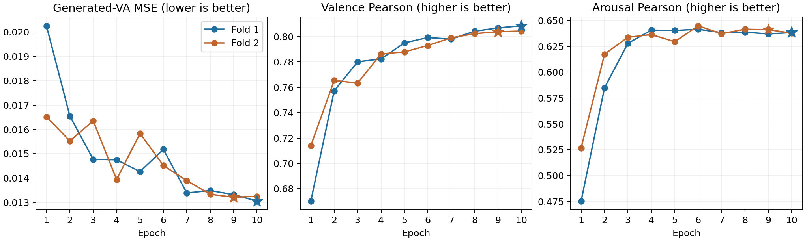

# DDPM + TRT 완료 결과 분석 — 2026-10-21

추가 검토: [REASSESSMENT.md](REASSESSMENT.md). 문장 개선의 fold 불일치,
출처별 arousal 편향 상쇄, 목적함수/샘플 수에 관한 인과 해석의 한계를
추가 확인했다. 원인과 후속 검증의 우선순위는 추가 검토를 함께 참고한다.

## 결론

이번 DDPM은 두 fold 모두 10 epoch를 완료했다. 저장된 최적 체크포인트의
53,791개 OOF 예측을 재계산한 평균 MSE는 **0.01313323**이다.
역사적 Raw TRT의 0.00988645보다 **32.84% 높고**, readout 회전의
0.01232392보다 **6.57% 높다**. 현재 설정이 기존 모델의 성능 개선에
성공했다는 증거는 없다. 단일 seed 일정의 서로 다른 모델 조건이며,
이 차이 전체를 DDPM만의 인과 효과로 해석할 수는 없다.

최적 epoch는 10과 9다. 초기 이후 지속적으로 악화되는 과적합 패턴으로
이번 결과를 설명하는 것은 부정확하다. 후반까지 valence가 개선되지만,
arousal Pearson은 두 fold 모두 약 0.64 부근에서 정체된다.

## 1. 검증 범위

- ZIP CRC 정상. 패키지에 기록된 25개 파일의 SHA256 모두 일치.
- 서버가 기록한 생산 코드 27개 파일의 SHA256이 현재 로컬 코드와 모두 일치.
- 두 원본 fold 파일의 SHA256이 로컬 데이터 및 비교 실행과 일치.
- 생산 DDPM packager의 완료 상태·모델 설정·최적 체크포인트·예측 해시
  검증을 임시 복사본에 재적용하여 통과. 원본 ZIP은 변경하지 않았다.
- 두 fold, 전체 OOF, 데이터셋별 지표를 예측값에서 재계산하여 일치 확인.
- DDPM의 원본 텍스트·데이터셋·정답·fold별 행 대응 모두 일치. 누락/중복 없음.
- fold 1의 16,820 step, fold 2의 16,810 step 모두 완료. 각각 최저 평가
  MSE와 최종 저장 예측의 MSE가 일치한다.

미완료 실행이나 잘못된 최종 epoch를 집계해서 생긴 결과가 아니다.
이 검증은 결과 보존 및 코드 동일성을 확인하며, CUDA 커널 전부의 정확성이나
모델 설계의 적합성을 증명하는 것은 아니다.

## 2. 실험 조건

Qwen3.5-0.8B-Base 전체 파인튜닝, frozen ET2 TRT prefix-concat,
last-text-token pooled context와 직접 token-TRT memory를 사용하는 조건이다.
재분배와 회전은 없다. BF16 autocast를 쓰되 학습 파라미터와 DDPM head는 FP32다.

- 데이터: no-IEMOCAP 전체 53,791개. sentence-only 실행이 아니다.
- 문장 출처 14,352개, 단어 출처 39,439개. 출처별 구분이며 토큰 수별 구분이 아니다.
- 학습 텍스트 중복 유지, 원래 두 fold 사용.
- base seed 42, fold별 seed 42/43. 독립적인 두 seed 반복 실험이 아니다.
- batch 8 × accumulation 2, 10 epoch, 최대 길이 200.
- encoder LR 6e-6, denoiser LR 1e-4.
- cosine DDPM T=100, epsilon MSE, 생성 표본 16개의 평균을 VA 예측으로 사용.
- Transformers 5.16.1, PyTorch 2.12.1+cu130, FLA 0.5.2.

## 3. 전체 OOF 비교

아래는 각 실행의 두 fold를 합친 53,791개 예측에서 계산한 지표다.
V=valence, A=arousal. 평균은 두 차원 지표의 산술평균이다.

| 조건 | MSE 평균 ↓ | Pearson V ↑ | Pearson A ↑ | RMSE V ↓ | RMSE A ↓ | MAE V ↓ | MAE A ↓ | CCC 평균 ↑ |
|---|---:|---:|---:|---:|---:|---:|---:|---:|
| 역사적 Raw TRT | **0.009886** | **0.85991** | **0.72036** | **0.08993** | **0.10810** | **0.06787** | **0.08215** | **0.77269** |
| Readout + TRT 회전 | 0.012324 | 0.81637 | 0.65699 | 0.10246 | 0.11895 | 0.07697 | 0.08886 | 0.72324 |
| 이번 DDPM + TRT | 0.013133 | 0.80612 | 0.63972 | 0.10729 | 0.12147 | 0.08054 | 0.09100 | 0.70450 |

DDPM의 역사적 Raw 대비 MSE 증가는 V 42.34%, A 26.27%다.
평균 MAE도 14.34% 높다. 단일 MSE 지표만의 문제가 아니다.

### 비교의 한계와 이전 Raw 메타데이터

세 실행은 데이터 파일 해시, Qwen/ET2 revision, 기본 seed 및 유효 batch 16을
공유한다. 그러나 역사적 Raw는 Transformers 5.14.1, BF16 dtype 기록,
batch 16 × accumulation 1, 이전 정렬 구현을 사용한다. 새로운 두 실행의
FP32 파라미터/BF16 autocast, batch 8 × accumulation 2와 동일한 조건이 아니다.
Readout 회전도 pooling, head, 목적함수, attention 설정 등이 DDPM과 다르다.

역사적 Raw TSV에서는 fold 1의 26,877행, fold 2의 26,885행에서 기록된
정답과 해당 텍스트 메타데이터의 원래 정답이 불일치한다. 각 fold의 정답
쌍의 multiset은 원본과 같고, 저장된 정답–예측 쌍으로 계산한 전체 지표는
기존 보고값과 일치한다. 이 파일을 역사적 전체 수치 참고로만 사용한다.
그 파일의 텍스트별·데이터셋별 수치와 DDPM의 행별 오차는 비교하지 않았다.
이번 분석에서 Raw의 sampler 순서를 복구하거나 메타데이터를 추정 수정하지 않았다.

DDPM과 readout 회전의 텍스트·정답 대응은 모두 원본과 일치한다.
아래 출처별 비교는 이 두 실행만 사용한다.

## 4. Fold별 최적 결과와 학습 곡선

| 평가 fold | 행 수 | 완료 epoch | 선택 epoch | MSE 평균 ↓ | Pearson V ↑ | Pearson A ↑ |
|---|---:|---:|---:|---:|---:|---:|
| 1 | 26,893 | 10 | 10 | 0.013054 | 0.80846 | 0.63845 |
| 2 | 26,898 | 10 | 9 | 0.013212 | 0.80380 | 0.64120 |



별표는 평균 MSE로 선택된 checkpoint다. 두 fold의 결과가 유사하므로
한 fold만 우연히 나빠서 전체 결과가 낮은 패턴은 아니다.
Fold 1은 epoch 8→10에서 MSE가 3.21% 추가 개선됐고 fold 2는 epoch 9가
최저다. 더 긴 학습의 가능성은 남아 있지만, epoch 연장만으로 Raw와의
격차가 닫힐 것이라는 근거는 없다. 특히 arousal 상관계수의 정체를 구분해야 한다.

## 5. 어느 데이터에서 차이가 생기나

| 출처 | N | 회전 MSE ↓ | DDPM MSE ↓ | DDPM의 MSE 변화 |
|---|---:|---:|---:|---:|
| EmoTales sentences | 1,395 | **0.014455** | 0.014661 | +1.43% |
| Emobank | 10,062 | 0.003816 | **0.003777** | −1.03% |
| fb | 2,895 | 0.018113 | **0.017596** | −2.85% |
| GlasgowNorms | 5,553 | **0.010366** | 0.010935 | +5.49% |
| nrc-vad | 19,971 | **0.016121** | 0.016892 | +4.78% |
| word ratings ENG | 13,915 | **0.012389** | 0.014300 | +15.42% |
| **문장 출처 합계** | **14,352** | 0.007734 | **0.007622** | **−1.45%** |
| **단어 출처 합계** | **39,439** | **0.013994** | 0.015139 | **+8.18%** |

전체 데이터의 73.32%가 단어 출처다. 문장 출처에서 DDPM의 MSE가 회전보다
약간 낮지만, 단어 출처에서는 모두 높다. 특히 word ratings ENG의 손실이 크다.
문장 출처의 MSE 개선도 Raw 대비 개선이나 통계적 재현성을 입증하지 않는다.
문장 출처의 V Pearson은 회전 0.73834 → DDPM 0.72607로 낮다.
여러 출처를 합친 상관계수는 출처별 평균 차이의 영향도 받으므로,
개별 출처 지표를 함께 확인해야 한다.

## 6. 오차의 형태

| 항목 | Valence | Arousal |
|---|---:|---:|
| 정답 평균 | 0.50376 | 0.46194 |
| DDPM 예측 평균 | 0.47991 | 0.46528 |
| 평균 편향: 예측 − 정답 | −0.02385 | +0.00334 |
| 정답 표준편차 | 0.17596 | 0.15549 |
| DDPM 예측값의 입력 간 표준편차 | 0.15185 | 0.12094 |
| MSE 중 평균 편향 제곱의 비중 | 4.94% | 0.076% |

Valence를 평균적으로 낮게 예측한다. 하지만 평균 편향만으로 전체 성능
격차를 설명할 수 없다. Arousal은 전체 평균이 가깝지만 Pearson이 낮다.
단순 상수 보정으로 Pearson은 바뀌지 않는다.

여기서 예측 표준편차는 **각 입력의 생성 표본 평균을 전체 입력에 걸쳐
계산한 값**이다. 개별 입력에서 16개 생성 표본이 얼마나 흩어지는지,
불확실성이 보정되어 있는지 측정한 값이 아니다. Raw의 arousal 예측
표준편차는 0.11768로 DDPM보다도 작지만 성능은 더 좋다. 따라서 예측 분포의
축소만을 DDPM 열세의 원인으로 지목해서도 안 된다.

## 7. 코드 리뷰와 연결되는 원인 후보

서버 생산 코드 27개 해시가 이전 리뷰의 로컬 코드와 모두 일치한다.
이제 이전 리뷰가 다른 구현을 대상으로 했을 가능성은 해당 파일 범위에서
제거됐다. 다음은 구현 사실이며, 실제 성능 격차에 대한 기여도는 아직 가설이다.

1. `diffusion_code/model.py:109`에서 기존 직접 회귀 head를 제거한다.
   과거 잘 학습된 Raw checkpoint에 DDPM을 추가한 실험이 아니다.
2. `model.py:153–155`에서 epsilon MSE만 최적화한다. 직접 VA 평균을
   맞추는 보조 손실은 없다. 노이즈 예측 향상과 최종 생성-VA 평균의 향상은
   동일하지 않다. 정답 VA는 noisy target을 만드는 정상적인 학습 경로로만
   쓰이며, 평가 샘플링에는 전달하지 않는다.
3. `model.py:159–163`에서 16개 생성값을 평균낸다. `ddpm.py:31–33,76–80`의
   공통 난수 bank는 재현성을 주지만 표본 평균의 유한 표본 오차를 제거하지
   않는다. 이번 ZIP에는 표본 평균만 있어 실제 sampling error를 분리할 수 없다.
4. 단어 출처에서도 DDPM의 TRT conditioning 경로는 존재한다. 예전 상대
   회전의 “단어 하나라서 회전이 0” 진단을 DDPM에 그대로 적용할 수 없다.
   직접 TRT memory가 실제로 얼마나 사용됐는지는 별도 개입 평가가 필요하다.

이전 리뷰의 149개 통과 테스트는 계산·gradient·저장·평가 계약의 검증이다.
이번 결과가 좋다는 증거도, 모든 가능한 버그를 배제하는 증거도 아니다.
현 결과에서는 행 정렬, 완료 여부, best checkpoint 집계 오류가 원인이라는
증거는 발견되지 않았다. T=100이 부족한 것이 원인이라고 확정할 증거도 없다.

## 8. 후속 우선순위

1. **재학습 전에 같은 보존 checkpoint 재평가:** T=100 유지, 표본 수
   16/64/256 및 사전에 정한 복수 sampling seed. 표본 수마다 난수 생성 shape이
   달라 완전히 중첩된 경로가 아니므로, 하나의 seed 개선만으로 결론 내리지 않는다.
   평균 및 변동을 보고하고 가장 좋은 sampling seed를 고르지 않는다.
   ZIP에는 가중치가 없으므로 이 작업은 서버의 가중치가 필요하다.
2. **조건 사용 진단:** 고정 timestep/noise에서 추가 직접 TRT memory만
   바꾸는 비교와 전체 condition을 바꾸는 비교를 분리한다. TRT prefix와
   pooled text가 남아 있는 상태에서 memory만 바꾸는 것은 전체 TRT 제거가 아니다.
   노이즈 수준별 epsilon 오차와 VA 복원 오차를 함께 본다.
3. **재학습을 한다면 대조군을 먼저 고정:** 같은 현재 코드·정밀도·batch의
   직접 MSE Raw TRT 모델을 기준으로, 직접 평균 head를 유지한 DDPM 보조/잔차
   조건을 비교하는 편이 합리적이다. 잔차 확산이 zero-mean이면 평균 예측을
   자동 개선하지 않으므로, 표현 학습 효과인지 평균 보정 효과인지 분리해야 한다.
   성능 개선을 보장하는 수정이 아니라 새로운 검증 대상이다.

OOF 정답으로 편향 보정 계수를 학습하거나 가장 유리한 noise seed를 고른
결과를 새 성능으로 보고하지 않았다. 의도된 fold 재사용과 학습 텍스트 중복은
변경하지 않았다. 생산 학습 코드는 이번 분석에서 수정하지 않았다.

## 파일 및 재현

- `analysis.json`: 입력 ZIP 해시, 검증 결과, 세 실행 manifest, 전체/잔차 지표.
- `overall_comparison.tsv`: 전체 지표.
- `subgroup_comparison.tsv`: 행 대응을 검증한 두 실행의 출처별 지표.
- `epoch_metrics.tsv`: DDPM 두 fold의 실제 epoch별 지표.
- `analyze.py`: 원본 ZIP을 읽어 분석을 재현하는 Python 스크립트.
- 이전 구현 리뷰: `../ddpm_review_20261021/REVIEW.md`.

프로젝트 의존성을 설치한 환경에서 저장소 루트 기준 실행:

```bash
python diagnostics/ddpm_results_20261021/analyze.py
```

입력 ZIP 세 개는 사용자의 `~/Downloads`에서 읽는다. 다른 위치에서는 스크립트의
`DOWNLOADS`/`ARCHIVES`를 지정하면 된다. 가중치를 읽거나 학습을 실행하지 않는다.
